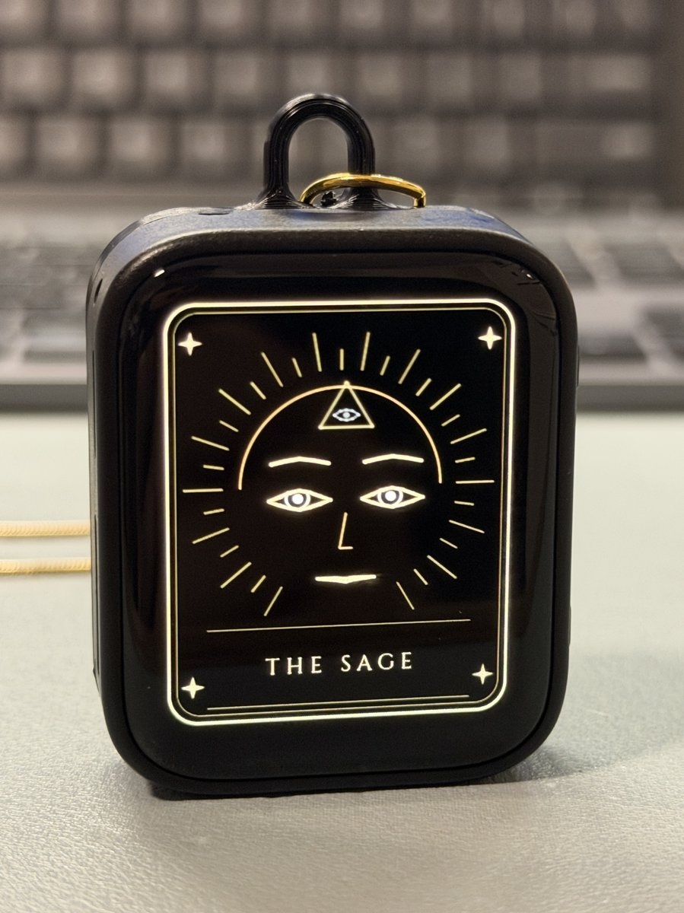
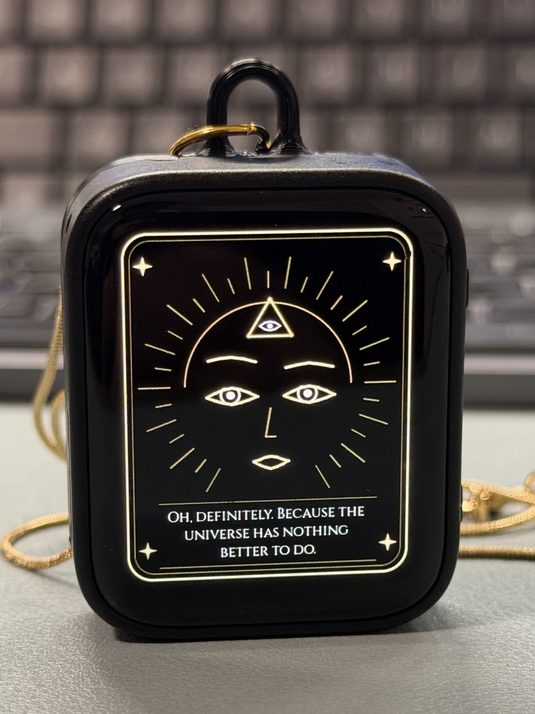
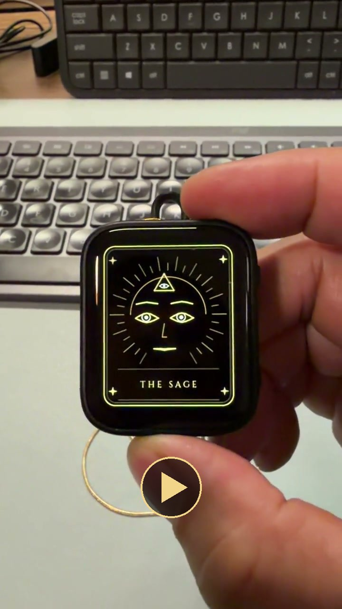
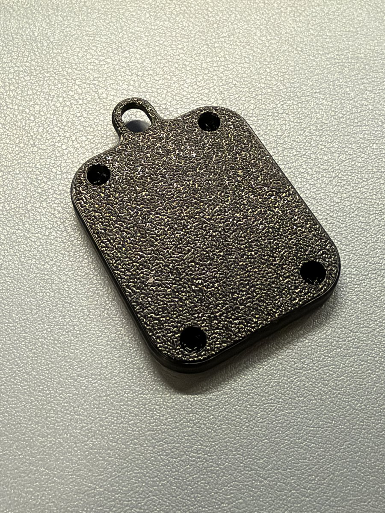
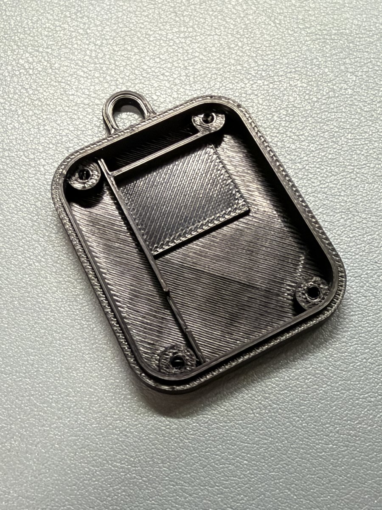

# The Sage: a Magic 8-Ball for the RP2350 AMOLED

A sarcastic fortune-teller that lives on a tarot card. Shake the
[Waveshare RP2350-Touch-AMOLED-1.8](https://www.waveshare.com/rp2350-touch-amoled-1.8.htm)
and the Sage answers out loud through the built-in speaker, lip-syncing
on a gold line-art card while the answer appears on the card's plate.

<p align="center">
  
  &nbsp;
  
</p>

## Demo

<p align="center">
  <a href="docs/media/demo.mp4">
    
  </a>
  <br>
  <em>Click to play the demo (MP4, 27 s, with sound).</em>
</p>

## Hardware

Everything is on one board, so there's no wiring:
[**Waveshare RP2350-Touch-AMOLED-1.8**](https://www.waveshare.com/rp2350-touch-amoled-1.8.htm).

It ships in a black case with a removable back cover. Two versions are sold:

| Version | Battery |
|---|---|
| `RP2350-Touch-AMOLED-1.8` | Includes a 3.7 V lithium battery that fits inside the case |
| `RP2350-Touch-AMOLED-1.8-EN` | No battery; runs from USB-C or a battery you add (MX1.25 connector, about 3.85 x 24 x 28 mm to fit the case) |

You also need a **microSD card** for the voice lines (included in this
repo, see [SD card layout](#sd-card-layout)).

On-board parts this project uses: SH8601 1.8" 368x448 AMOLED, FT3168 touch,
QMI8658 6-axis IMU, ES8311 audio codec with speaker, AXP2101 power
management, and the microSD slot.

### Pendant / keychain back lid

[`hardware/rp2350-pendant-back-lid.stl`](hardware/rp2350-pendant-back-lid.stl)
is a replacement back cover with a loop on top, so the device can hang
from a chain or key ring. It replaces the stock back cover and lines up
with the case's four corner screws. Overall size is about
37.6 x 54.1 x 5.8 mm.

<p align="center">
  
  &nbsp;
  
</p>

## How it works

- **Shake to ask.** Hold a vigorous shake for about 2 seconds. A shake
  sound plays while you shake; stop early and it cancels. Hold the full
  2 seconds and the third eye throws sparks, an intro sound plays, then
  the Sage speaks a random answer while its caption appears on the plate.
- **Three moods.** Each answer is tagged ominous, sarcastic, or dry, and
  the face changes expression to match (brows, eye opening, mouth curve,
  third-eye pulse speed).
- **Lip sync.** The mouth follows the loudness and sibilance of the
  audio in real time.
- **Alive when idle.** Random blinks, wandering gaze, a gentle floating
  bob, and twinkling corner stars. Picking it up makes the Sage perk up.
- **Auto-rotate.** Hold it upside down and the whole screen flips 180
  degrees, touch included. Lying flat keeps the last orientation.
- **Boot.** The card fades in with a "THE SAGE" title, which fades away
  after a few seconds.

## Controls

| Button | Action |
|---|---|
| **BOOT** | Cycle volume (Quiet, Medium, Loud). A short tone previews the new level, and a status bar briefly shows battery level and volume. Ignored while audio is playing. |
| **PWR**, tap | Sleep or wake. |
| **PWR**, hold about 10 s | Power off (handled by the power-management chip). |

The device also sleeps on its own after 30 seconds without activity.
Tap **PWR** to wake it.

## SD card layout

The ready-to-use audio is in this repo. Format a microSD card as FAT32 and
copy:

| From this repo | To the SD card |
|---|---|
| `voicelines/wav/*.wav` | `voicelines/` (the answers, picked at random) |
| `voicelines/sfx/answer.wav` | `sfx/answer.wav` (boot intro, and the lead-in before each answer) |
| `voicelines/sfx/shake.wav` | `sfx/shake.wav` (loops while you're shaking) |

All WAV files must be 24 kHz, mono, 16-bit PCM. To write your own answers,
the scripts are in [`voicelines/SCRIPT.md`](voicelines/SCRIPT.md) and the
conversion workflow is in [`voicelines/README.md`](voicelines/README.md).

Captions and moods are compiled into the firmware from `SCRIPT.md`, so
a WAV only gets a caption if its file name matches an entry there.

## Build and flash

### Toolchain

- VS Code with the **Raspberry Pi Pico** extension
  (`raspberry-pi.raspberry-pi-pico`). It bundles the Pico SDK, ARM
  toolchain, CMake, Ninja, and picotool.
- Versions are pinned in [`CMakeLists.txt`](CMakeLists.txt): Pico SDK
  2.2.0, Arm GNU toolchain 14.2.Rel1, picotool 2.2.0-a4. Board: `pico2`.
- The microSD library
  ([no-OS-FatFS-SD-SDIO-SPI-RPi-Pico](https://github.com/carlk3/no-OS-FatFS-SD-SDIO-SPI-RPi-Pico)
  v3.6.2) is downloaded automatically when CMake configures the project.

First time: open this folder in VS Code, then in the Pico sidebar choose
**Import Project**, select SDK 2.2.0, and board **pico2**. The first run
downloads about 1 GB of tools.

### Build

Pico sidebar, then **Compile Project**. The output is
`build/magic_8_ball.uf2`.

### Flash

1. Hold **BOOT** while plugging in USB.
2. The board appears as a USB drive named `RP2350`.
3. Drag `build/magic_8_ball.uf2` onto it. It reboots into the firmware.

### Serial log

USB serial is enabled. After flashing, the board shows up as a new COM
port; any baud rate works. The log includes boot steps, state changes,
and IMU readings.

## Project layout

```
.
├── main.c                  # entry point; calls app_run()
├── app/                    # the Magic 8-Ball app
│   ├── app.c               # boot sequence and main state machine
│   ├── sage_face.c         # tarot card face, poses, lip sync, animations
│   ├── screen_orient.c     # 180-degree auto-rotate from the IMU
│   ├── shake_detect.c      # shake-and-hold gesture
│   ├── sleep_mgr.c         # idle timeout and PWR-button sleep / wake
│   ├── wav_player.c        # streams WAVs from SD to the codec
│   ├── voicelines.c        # indexes and picks answers on the SD card
│   ├── font_cinzel_*.c     # generated fonts (see tools/gen_fonts.ps1)
│   └── ...                 # volume, SD, BOOT button, LVGL glue
├── lib/                    # board drivers (mostly from Waveshare) and LVGL 8.1
├── tools/                  # voiceline conversion, caption / mood table and font generators
├── voicelines/             # answer scripts and ready-to-copy WAVs for the SD card
├── hardware/               # pendant back lid STL
└── docs/media/             # README photos and demo video
```

## Credits

- Board drivers are based on Waveshare's example code for this board,
  including the PIO-based QSPI driver that makes the AMOLED usable from
  the Pico SDK.
- [LVGL](https://lvgl.io) for graphics.
- [Cinzel](https://github.com/NDISCOVER/Cinzel) by The Cinzel Project
  Authors, under the SIL Open Font License (see
  [`tools/fonts/OFL.txt`](tools/fonts/OFL.txt)).
- [no-OS-FatFS-SD-SDIO-SPI-RPi-Pico](https://github.com/carlk3/no-OS-FatFS-SD-SDIO-SPI-RPi-Pico)
  by Carl Kugler for microSD support.
